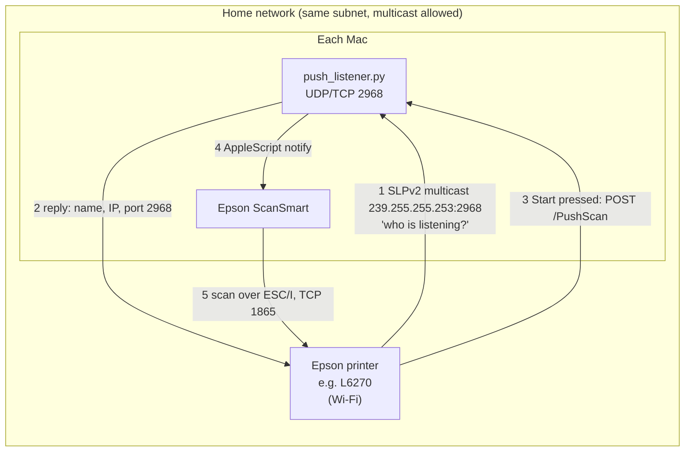

# epson-scan-to-mac

**Make the "Scan → Computer" button on Epson printers work with Apple silicon Macs again.**

[繁體中文說明](README.zh-TW.md)

On an Epson all-in-one, **Scan → Computer** on the control panel only lists computers that run
**Epson Event Manager**. On macOS, Epson ships Event Manager (and its Scanner Monitor) **as Intel-only binaries**.
On an Apple silicon Mac without Rosetta 2 it never starts (`Bad CPU type in executable`), so the panel says
it cannot find a computer. Apple has said Rosetta will stop being available to general apps after macOS 27
([AppleInsider](https://appleinsider.com/articles/26/06/12/how-and-when-macos-will-finally-stop-support-for-intel-apps)),
and there is no native Event Manager from Epson.

The scanning app itself, **Epson ScanSmart**, *is* native. Only the small piece that answers the printer was
missing. So we recorded what Event Manager says to the printer on a Windows laptop, worked out the protocol,
and rewrote that piece as a ~200-line Python script with no dependencies.

> Not affiliated with or endorsed by Seiko Epson. The protocol was worked out from the network traffic between
> our own printer and Epson's Windows software. No Epson code or binaries are included.

## What's in here

| File | What it does |
|---|---|
| `push_listener.py` | Answers the panel's **Scan → Computer** like Event Manager does, and when Start is pressed tells **Epson ScanSmart** to scan. You get ScanSmart's preview and can save as PDF, JPEG, etc. |
| `install.sh` / `uninstall.sh` | Run `push_listener.py` at login as a LaunchAgent (and optionally stop the dead Intel Event Manager from launching). |
| `scan_listener.py` | Alternative without any Epson software: registers the Mac under **Scan → Computer (WSD)** and saves JPEGs straight into a folder. |
| [`docs/protocol.md`](docs/protocol.md) | The protocol, byte by byte. |
| [`docs/capturing.md`](docs/capturing.md) | How the traffic was captured on Windows, and how to check another printer model. |

## How it works



1. When you choose **Scan → Computer**, the printer multicasts an SLPv2 query for `service:NetScanMonitor-agent`.
   Each listening computer replies with its name, IP and event port, and the panel lists it.
2. When you pick a computer and press Start, the printer sends `POST /PushScan` to that computer.
3. The listener replies `200 OK` and calls ScanSmart's AppleScript command
   `notify kind "invokejob" scanner … ipaddress … jobinfo …`. ScanSmart then scans over Epson's ESC/I protocol.

Every Mac runs its own listener and answers for itself, so the panel lists all of them, same as on Windows.

## Requirements

- macOS on Apple silicon or Intel. Python 3.9 or newer: the Xcode Command Line Tools one
  (`xcode-select --install`) or Homebrew's. No packages to install.
- Epson Event Manager itself is **not** needed, but ScanSmart checks that
  `/Applications/Epson Software/Event Manager.app` exists and otherwise refuses panel scans with
  "required files not found. Make sure Epson Scan 2 and Epson Event Manager are installed". If it is missing,
  `install.sh` creates an empty folder with that name (asks for an administrator password). Don't delete it.
- **Epson ScanSmart** installed, and able to scan from the printer over the network at least once
  (that is also how the listener learns the scanner's name).
- The Mac and the printer on the same subnet, with multicast passing between them (normal for home routers).

## Install

```bash
git clone https://github.com/Sigma-Snaken/epson-scan-to-mac.git
cd epson-scan-to-mac
bash install.sh            # the panel shows this Mac's computer name
bash install.sh MBP        # ...or a name of your choice (ASCII; the panel may not show other scripts)
```

`install.sh` copies the script to `~/Library/Application Support/epson-pushscan/`, starts it now and at every
login (restarting it if it dies), and logs to `~/Library/Logs/epson-pushscan.log`.

Options:

- `--disable-event-manager`: remove the launch agents of Epson Event Manager and Epson Scanner Monitor so macOS
  stops trying to start them (asks for an administrator password). The apps themselves are kept.
- `--scanner "EPSON L6270 Series"`: the scanner name as ScanSmart shows it, if you have more than one Epson
  scanner. By default the listener uses the one ScanSmart used last.

The first time you press Start, macOS asks whether `python3` may control "Epson ScanSmart". Click **Allow**.

To remove: `bash uninstall.sh`.

## Use

On the printer: **Scan → Computer** → pick your Mac → Start. ScanSmart comes to the front, scans and shows the
preview; save from there.

> Choose **Computer**, not **Computer (WSD)**. They are different menu items; `push_listener.py` answers the first
> one, `scan_listener.py` the second.

The Mac has to be awake. It drops off the panel list while it sleeps or is away, and reappears once it is back on
the network. If its IP changes, the listener restarts itself and announces the new address.

### Alternative: WSD straight to a folder (no Epson software)

```bash
python3 scan_listener.py --printer 192.168.1.20 --out ~/Documents/Scans
```

The panel then lists `<name> Glass` (flatbed) and `<name> ADF` (feeder, whole stack) under
**Scan → Computer (WSD)**. Scans are saved as JPEG. On the L6270, WSD only offers JPEG at 100 or 300 dpi with
the quality fixed at 50, which is why the ScanSmart route above exists. `install.sh` does not install this one;
run it yourself or write your own LaunchAgent for it.

## Troubleshooting

| Symptom | Check |
|---|---|
| Panel says no computer found | `tail -f ~/Library/Logs/epson-pushscan.log`: choosing Scan → Computer should log `Panel is looking for computers`. If nothing is logged, the query is not reaching the Mac: different subnet / VLAN, guest network, or multicast filtered by the router. Make sure you chose **Computer**, not **Computer (WSD)**. |
| Mac listed, but nothing happens on Start | The log should show `Start pressed on the panel`. Then make sure ScanSmart can scan from the printer by itself, and that "python3 may control Epson ScanSmart" was allowed (System Settings → Privacy & Security → Automation). For ScanSmart's own log, create a folder named `_ScanManagerLog` on the Desktop, try again, read the log inside, then delete the folder. |
| ScanSmart opens but says required files are not found (Epson Scan 2 / Epson Event Manager) | `/Applications/Epson Software/Event Manager.app` is missing. Run `bash install.sh` again (it creates an empty placeholder), or `sudo mkdir "/Applications/Epson Software/Event Manager.app"`. |
| `Could not find the scanner name` in the log | Open ScanSmart and scan once, or reinstall with `--scanner "<name as ScanSmart shows it>"`. |
| `Address already in use` | Something else holds port 2968, e.g. Event Manager running under Rosetta. Quit it or reinstall with `--disable-event-manager`. |

## Tested with

| | |
|---|---|
| Printer | EPSON L6270 (Epson Scan 2 model ES0223) over Wi-Fi |
| Mac | Apple silicon, macOS 27, no Rosetta |
| Software | Epson ScanSmart 3.7.17, Epson Scan 2 model bundle 6.7.84.1 |
| Reference capture | Epson Event Manager + ScanSmart on a Windows laptop |

Other Epson models that use Event Manager for "Scan to Computer" probably speak the same protocol, but only the
L6270 has been tried. If it works (or doesn't) with your printer, please open an issue with the model name;
[`docs/capturing.md`](docs/capturing.md) explains how to capture what your printer sends.

## Development

```bash
python3 -m unittest discover -s tests
python3 push_listener.py --debug     # run in the foreground (stop the LaunchAgent first: bash uninstall.sh)
```

The tests replay the packets captured from the printer and from Event Manager and check the replies byte for byte.

## License

[MIT](LICENSE). Epson, ScanSmart and Epson Scan are trademarks of Seiko Epson Corporation.
