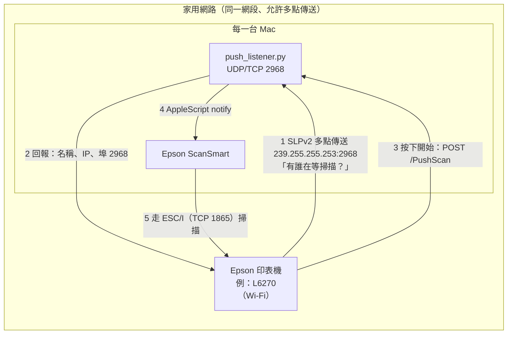

# epson-scan-to-mac

**讓 Epson 印表機面板上的「掃描 → 電腦」，在 Apple 晶片 Mac 上重新能用。**

[English](README.md)

Epson 事務機面板上的「掃描 → 電腦」，只會列出有在跑 **Epson Event Manager** 的電腦。Epson 給 macOS 的
Event Manager（和它的 Scanner Monitor）**只有 Intel 版**。Apple 晶片的 Mac 沒裝 Rosetta 2 時，它根本啟動不了
（`Bad CPU type in executable`），面板就一直顯示找不到電腦。Apple 已表示 macOS 27 之後，一般 App 將無法再使用
Rosetta（[AppleInsider](https://appleinsider.com/articles/26/06/12/how-and-when-macos-will-finally-stop-support-for-intel-apps)），
而 Epson 目前也沒有原生版的 Event Manager。

真正負責掃描的 **Epson ScanSmart** 其實是原生版，缺的只是「回應印表機」的那一小段。所以我們用一台 Windows
筆電錄下 Event Manager 和印表機之間的封包，解出協定，再用約 200 行、不需要任何套件的 Python 把這段補回來。

> 本專案與 Seiko Epson 無關，也未經其背書。協定是觀察自家印表機與 Epson Windows 軟體之間的網路封包得來，
> 不含任何 Epson 的程式碼或執行檔。

## 內容

| 檔案 | 用途 |
|---|---|
| `push_listener.py` | 像 Event Manager 一樣回應面板的「掃描 → 電腦」，按下開始後叫 **Epson ScanSmart** 掃描。會出現 ScanSmart 的檢視畫面，可存成 PDF、JPEG 等格式。 |
| `install.sh`／`uninstall.sh` | 把 `push_listener.py` 設成登入後自動執行（LaunchAgent），可選擇一併刪掉跑不起來的 Intel 版 Event Manager。 |
| `scan_listener.py` | 不需要任何 Epson 軟體的替代方案：在「掃描 → 電腦（WSD）」登記這台 Mac，把 JPEG 直接存進資料夾。 |
| [`docs/protocol.md`](docs/protocol.md) | 協定細節，逐位元組說明（英文）。 |
| [`docs/capturing.md`](docs/capturing.md) | 怎麼在 Windows 錄封包，以及怎麼驗證其他型號（英文）。 |

## 運作方式



1. 在面板選「掃描 → 電腦」時，印表機用 SLPv2 多點傳送詢問 `service:NetScanMonitor-agent`。
   每台有在聽的電腦回報自己的名稱、IP 和事件埠，面板就把它列出來。
2. 選了某台電腦、按下開始，印表機就對那台電腦送 `POST /PushScan`。
3. 程式回 `200 OK`，再呼叫 ScanSmart 的 AppleScript 指令
   `notify kind "invokejob" scanner … ipaddress … jobinfo …`，由 ScanSmart 用 Epson 的 ESC/I 協定掃描。

每台 Mac 各跑一份、各自回應，所以面板會列出每一台，跟 Windows 上的行為一樣。

## 需求

- macOS（Apple 晶片或 Intel 皆可）。Python 3.9 以上：Xcode 命令列工具內建的（`xcode-select --install`）
  或 Homebrew 的都可以，不需要安裝任何套件。
- 已安裝 **Epson ScanSmart**，且至少用它透過網路掃過一次這台印表機（程式也是從這裡得知掃描器名稱）。
- Mac 和印表機在同一個網段，且兩者之間可以收送多點傳送封包（一般家用路由器都可以）。

## 安裝

```bash
git clone https://github.com/Sigma-Snaken/epson-scan-to-mac.git
cd epson-scan-to-mac
bash install.sh            # 面板上顯示這台 Mac 的電腦名稱
bash install.sh MBP        # 或自訂名稱（請用英數字，面板不一定顯示得了中文）
```

`install.sh` 會把程式複製到 `~/Library/Application Support/epson-pushscan/`，立刻啟動並設成每次登入自動執行
（掛掉會自己重開），紀錄寫在 `~/Library/Logs/epson-pushscan.log`。

選項：

- `--remove-event-manager`：一併刪除 Epson Event Manager 和 Epson Scanner Monitor（會要求輸入管理者密碼）。
  ScanSmart、Epson Scan 2、印表機驅動程式和 Epson Software Updater 都不會動到。
- `--scanner "EPSON L6270 Series"`：ScanSmart 顯示的掃描器名稱，有多台 Epson 掃描器時才需要指定。
  預設使用 ScanSmart 上次用的那台。

第一次按開始時，macOS 會問「python3 想要控制 Epson ScanSmart」，請按「允許」。

移除：`bash uninstall.sh`。

## 使用

在印表機面板：**掃描 → 電腦** → 選你的 Mac → 開始。ScanSmart 會跳到前景、開始掃描並顯示檢視畫面，在那裡存檔。

> 請選「**電腦**」，不是「**電腦（WSD）**」。這是兩個不同的選項：`push_listener.py` 回應前者，
> `scan_listener.py` 回應後者。

Mac 必須是醒著的。睡眠或離開家裡網路時，面板上就不會列出它；回到網路後會再出現。IP 變了的話，程式會自己重開、
回報新的 IP。

### 替代方案：WSD 直接存到資料夾（不需要 Epson 軟體）

```bash
python3 scan_listener.py --printer 192.168.1.20 --out ~/Documents/Scans
```

之後在面板的「掃描 → 電腦（WSD）」會看到 `<名稱> Glass`（玻璃面）和 `<名稱> ADF`（進紙器，一次掃整疊），
檔案存成 JPEG。L6270 的 WSD 只提供 JPEG、100 或 300 dpi、壓縮品質固定 50，所以才有上面 ScanSmart 那條路。
`install.sh` 不會安裝這支，要用的話請自行執行或另外設定 LaunchAgent。

## 疑難排解

| 狀況 | 檢查 |
|---|---|
| 面板顯示找不到電腦 | `tail -f ~/Library/Logs/epson-pushscan.log`：在面板選「掃描 → 電腦」時應該出現 `Panel is looking for computers`。沒有的話，代表詢問沒傳到 Mac：不同網段／VLAN、訪客網路，或路由器擋了多點傳送。也請確認選的是「電腦」而不是「電腦（WSD）」。 |
| 有列出 Mac，但按開始沒反應 | 紀錄裡應該要有 `Start pressed on the panel`。接著確認 ScanSmart 自己能掃這台印表機，以及「python3 控制 Epson ScanSmart」已允許（系統設定 → 隱私權與安全性 → 自動化）。要看 ScanSmart 自己的紀錄：在桌面建一個叫 `_ScanManagerLog` 的資料夾，再試一次，看裡面的紀錄，看完把資料夾刪掉。 |
| 紀錄出現 `Could not find the scanner name` | 打開 ScanSmart 掃一次，或用 `--scanner "<ScanSmart 顯示的名稱>"` 重新安裝。 |
| `Address already in use` | 有別的程式佔用 2968 埠，例如透過 Rosetta 執行的 Event Manager。把它關掉，或加 `--remove-event-manager` 重新安裝。 |

## 測試環境

| | |
|---|---|
| 印表機 | EPSON L6270（Epson Scan 2 型號 ES0223），Wi-Fi 連線 |
| Mac | Apple 晶片、macOS 27、沒有 Rosetta |
| 軟體 | Epson ScanSmart 3.7.17、Epson Scan 2 型號套件 6.7.84.1 |
| 錄封包用 | Windows 筆電上的 Epson Event Manager＋ScanSmart |

其他用 Event Manager 做「掃描到電腦」的 Epson 型號，應該是同一套協定，但目前只實測過 L6270。
如果你的印表機能用（或不能用），歡迎開 issue 告訴我們型號；[`docs/capturing.md`](docs/capturing.md) 說明了怎麼錄下你的印表機送出的封包。

## 開發

```bash
python3 -m unittest discover -s tests
python3 push_listener.py --debug     # 在前景執行（先用 bash uninstall.sh 停掉背景那份）
```

測試會重播從印表機和 Event Manager 錄到的封包，逐位元組比對程式的回應。

## 授權

[MIT](LICENSE)。Epson、ScanSmart、Epson Scan 為 Seiko Epson Corporation 的商標。
