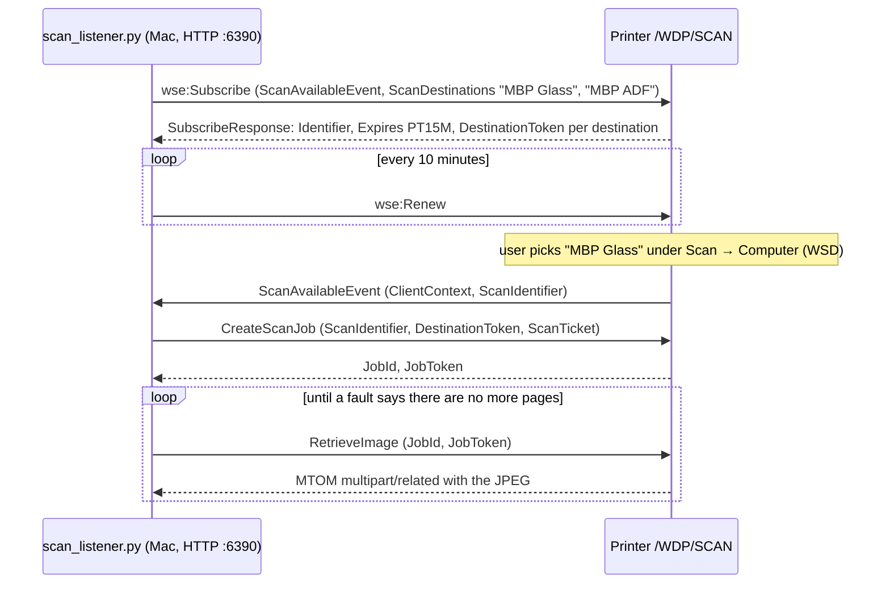

# Protocol notes

Everything here was observed on one **EPSON L6270** (Epson Scan 2 model `ES0223`, USB product ID `0x1181`)
by recording what Epson Event Manager on Windows exchanges with the printer, then reproducing it from a Mac.
Host names and IP addresses in the examples were replaced; all length fields are exactly as captured.

There are two independent ways to get a scan out of the panel:

| Panel menu | Protocol | Who scans | Implemented by |
|---|---|---|---|
| Scan → **Computer** | Epson "Net Scan Monitor" (SLPv2 + HTTP `POST /PushScan`), then ESC/I on TCP 1865 | Epson ScanSmart | `push_listener.py` |
| Scan → **Computer (WSD)** | WS-Scan (SOAP, WS-Eventing) | the listener itself | `scan_listener.py` |

## Ports seen

| Port | Direction | Purpose |
|---|---|---|
| UDP 2968, multicast `239.255.255.253` | printer → LAN | SLPv2 AttrRqst: "which computers are listening?" |
| UDP 2968 unicast | computer → printer | SLPv2 AttrRply: name, IP, event port |
| TCP 2968 (the advertised `EventPort`) | printer → computer | `POST /PushScan` when Start is pressed |
| TCP 1865 | computer → printer | ESC/I scan session (ScanSmart / Epson Scan 2) |
| UDP 3289, UDP 161 | computer → printer | Epson's own discovery and SNMP status from the scan software; not needed by the listener |
| TCP 80 `/WDP/SCAN` | computer → printer | WS-Scan endpoint (note: `/WDP/`, not the usual `/WSD/`) |

## Scan → Computer

```mermaid
sequenceDiagram
    participant P as Printer panel
    participant L as push_listener.py (Mac)
    participant S as Epson ScanSmart (Mac)
    P->>L: SLPv2 AttrRqst, UDP multicast 239.255.255.253:2968<br/>service:NetScanMonitor-agent, ClientName,IPAddress,EventPort
    L-->>P: SLPv2 AttrRply (ClientName=MBP),(IPAddress=…),(EventPort=2968)
    Note over P: panel lists every computer that answered
    P->>L: TCP 2968: POST /PushScan (PushScanIDIn=04, IPAddressIn=printer IP)
    L-->>P: HTTP/1.0 200 OK, StatusOut=OK
    L->>S: AppleScript: notify kind "invokejob" scanner … ipaddress … jobinfo …
    S->>P: ESC/I over TCP 1865: scan
    Note over S: ScanSmart opens its preview window;<br/>save as PDF / JPEG / … from there
```

**No registration is needed beforehand.** The printer asks the network each time "Computer" is chosen on
the panel. A computer that does not answer is simply not listed — this is why a Mac without a running
Event Manager shows "computer not found".

### 1. SLPv2 attribute request (printer → multicast)

The printer sends the same request three times within ~35 ms (92 bytes):

```
02 06 00 00 5c 20 00 00 00 00 00 0b 00 02 65 6e   version 2, function 6 (AttrRqst), length 0x5c,
                                                  flags 0x2000 (request multicast), XID 0x000b, lang "en"
00 00                                             previous responder list: empty
00 1c  service:NetScanMonitor-agent               URL
00 08  PID 1181                                   scope list = "PID " + USB product ID in hex
00 1e  ClientName,IPAddress,EventPort             tag list
00 00                                             SLP SPI: empty
```

`PID 1181` matches ScanSmart's preferences for the same printer (`previousScanner.productID = 4481 = 0x1181`).

### 2. SLPv2 attribute reply (computer → printer, unicast)

88 bytes as Event Manager sends it. `push_listener.py` produces this byte for byte (see `tests/`):

```
02 07 00 00 58 00 00 00 00 00 00 0b 00 02 65 6e   function 7 (AttrRply), length 0x58, flags 0,
                                                  same XID and language tag as the request
00 00                                             error code 0
00 43  (ClientName=WIN-LAPTOP),(IPAddress=192.168.10.103),(EventPort=2968)
00                                                attribute auth blocks: 0
```

The panel shows `ClientName`. Event Manager on Windows repeats the reply three times, 0.5 s apart; answering
every request once was enough in practice.

### 3. `POST /PushScan` (printer → computer, TCP `EventPort`)

About 7 s after the AttrRply (the time it took to pick the computer and press Start):

```http
POST /PushScan HTTP/1.0
Content-Type: application/octet-stream
Content-Length: 306
x-protocol-name: Epson Network Service Protocol
x-protocol-version: 2.00
x-uid: 1

<?xml version="1.0" ?><s:Envelope xmlns:s="http://www.w3.org/2003/05/soap-envelope"><s:Body><p:PushScan xmlns:p="http://schema.epson.net/EpsonNet/Scan/2004/pushscan"><ProductNameIn>PID 1181</ProductNameIn><IPAddressIn>C0A80AAB</IPAddressIn><PushScanIDIn>04</PushScanIDIn></p:PushScan></s:Body></s:Envelope>
```

- `IPAddressIn` is the printer's IPv4 address as 8 hex digits (`C0A80AAB` = 192.168.10.171).
- `x-uid` counts up per request (1, 2, 3, …); the reply echoes it.
- `PushScanIDIn` is the panel button. Epson Scan 2's per-model file
  `/Library/Image Capture/Support/EPSON/Epson Scan 2/Models/ES0223/ES0223.bundle/Contents/Resources/ScanSmart.plist`
  maps `button1 = JPEG`, `button2 = PDF`, `button4 = Normal`. The L6270 panel only ever sent `04`.

### 4. Reply (computer → printer)

Copied from Event Manager, including its unusual `Header : value` spacing:

```http
HTTP/1.0 200 OK
Server : Epson Net Scan Monitor/2.0
Content-Type : application/octet-stream
Content-Length : 276
x-protocol-name : Epson Network Service Protocol
x-protocol-version : 2.00
x-uid : 1
x-status : 0001

<?xml version="1.0" ?>
<s:Envelope xmlns:s="http://www.w3.org/2003/05/soap-envelope">
  <s:Body>
    <p:PushScanResponse xmlns:p="http://schema.epson.net/EpsonNet/Scan/2004/pushscan">
      <StatusOut>OK</StatusOut>
    </p:PushScanResponse>
  </s:Body>
</s:Envelope>
```

(Body lines end with CRLF.) After this the printer waits for a scan client on TCP 1865.

### 5. Handing over to ScanSmart (macOS)

The scan itself is ESC/I, which Epson ScanSmart (native on Apple silicon) already speaks. ScanSmart has a
scripting dictionary, `Epson ScanSmart.app/Contents/Resources/ScanSmart.sdef`, with one command:

```
notify (ScMgNtfy)  kind: text, scanner: text, ipaddress: text, isLast: text (optional), jobinfo: text (optional)
```

What works:

```applescript
tell application id "com.epson.scan.Epson-ScanSmart"
    notify kind "invokejob" scanner "EPSON L6270 Series" ipaddress "192.168.10.171" jobinfo "/tmp/epson-pushscan-no-job"
end tell
```

- **`jobinfo` is required in practice** even though the dictionary marks it optional. Without it ScanSmart
  logs `no jobinfo` and does nothing. With a path to a file that does not exist, it runs
  `startPushScan` → checks the scanner → scans → opens its preview ("document edit") window.
- `scanner` is the TWAIN / display name. ScanSmart stores the last one used in
  `~/Library/Preferences/com.epson.scan.Epson-ScanSmart.plist` → `previousScanner.displayName`, which is where
  `push_listener.py` reads its default from. The Epson Scan 2 model bundle lists the same string under
  `ESTWAINIDForUpdate`.
- **Debug log:** create a folder named `_ScanManagerLog` on the Desktop and ScanSmart writes its log there.
  Delete the folder afterwards.
- The first time, macOS asks whether `python3` (or `osascript`) may control Epson ScanSmart. Allow it.

## Scan → Computer (WSD)

Standard WS-Scan. The endpoint on this printer is `http://<printer>:80/WDP/SCAN`.



Findings:

- The subscription must carry `wscn:ScanDestinations`; one destination per `ClientDisplayName` shows up on the
  panel. Use ASCII names; the panel display may not render others.
- The printer grants at most `PT15M` whatever is requested, so the listener renews every 10 minutes and
  subscribes again (new tokens) if a renew fails, e.g. after the printer rebooted.
- The `Subscribe` shape that worked mirrors Windows: Push delivery mode, `EndTo` and `NotifyTo` both carrying
  `ReferenceParameters`.
- Limits reported by the L6270 (`ScannerConfiguration` / `DefaultScanTicket`): format `exif` (JPEG) only,
  100 or 300 dpi, `CompressionQualityFactor` fixed at 50, scaling fixed at 100, ADF present but no duplex,
  maximum area 8500 × 11700 (1/1000 inch).
- An A4 scan at 300 dpi came back as 2480 × 3504 pixels.
